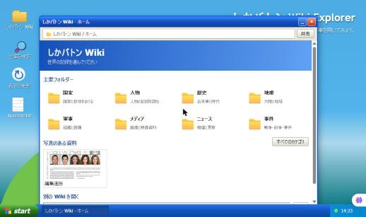
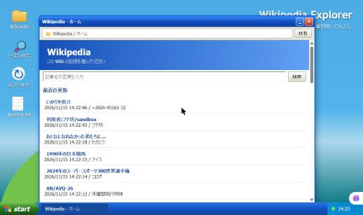

# Wiki Explorer

MediaWiki のカテゴリをフォルダー、記事をファイルとして、Windows XP 風のデスクトップで歩けるブラウザ用ビューアーです。
静的ファイル3つだけで動き、サーバー側の設定は要りません。公開 Wiki の API を読むだけなので、Wikipedia を含むどの MediaWiki にも向けられます。

**[ブラウザで開く](https://a2taka-sourse.github.io/geno-wiki-explorer/)** ／ [Wikipedia 日本語版で開く](https://a2taka-sourse.github.io/geno-wiki-explorer/?wiki=https://ja.wikipedia.org)



## 自分の Wiki に向ける

URL に `?wiki=` で Wiki のドメインを付けます。

```
https://a2taka-sourse.github.io/geno-wiki-explorer/?wiki=https://ja.wikipedia.org
https://a2taka-sourse.github.io/geno-wiki-explorer/?wiki=https://example.miraheze.org
```

- API が `/w/api.php` 以外にある Wiki は `?api=` で API の URL を直接指定します。
- 開いた画面のホームにある「別の Wiki を開く」からも切り替えられます。
- 共有リンクにはこの指定が引き継がれます。



指定がないときは、共同制作の架空世界「下腦（geno）」の Wiki に、テーマ別の専用ホーム画面付きでつながります。既定の接続先は [app.js](./app.js) 冒頭の `DEFAULT_WIKI` で変えられます。

## できること

- カテゴリをフォルダー、記事をファイルとして探索
- Wiki の全文検索
- 最近の更新の表示
- 記事本文をビューアー内で閲覧し、元の Wiki 記事へ移動
- 画像付き記事のサムネイルと画像ビューアー
- 記事・カテゴリを直接開く共有リンク

## 手元で動かす

```sh
python -m http.server 8000
```

`http://localhost:8000/` を開きます。GitHub Pages、Cloudflare Pages、Netlify などの静的ホスティングに `index.html`、`styles.css`、`app.js` を置けば公開できます。

接続の確認には、Node.js 20 以上で次を実行します。Wikipedia 日本語版と既定の Wiki に、アプリと同じ API 呼び出しを送って応答を検査します。

```sh
node test/check_api.mjs
```

## 仕組みと権限

閲覧専用で、MediaWiki の公開 API（`origin=*` 付きの匿名リクエスト）だけを呼びます。管理者のトークンやパスワードは使いません。
編集や画像投稿を足す場合は、利用者本人が Wiki にログインした状態で CSRF トークンを取る設計にし、資格情報を公開サイトに埋め込まないでください。

## 実例

共同制作の架空世界「下腦（geno）」で、MediaWiki へ1,334記事を移行した際に、記事・画像・カテゴリを確かめる道具として作りました。

「Wiki を Windows のデスクトップとして歩く」発想は [explorer.samismith.com](https://explorer.samismith.com/) から得ました。

## License

コードは MIT。表示される記事と画像は、それぞれの Wiki のライセンスに従います。
